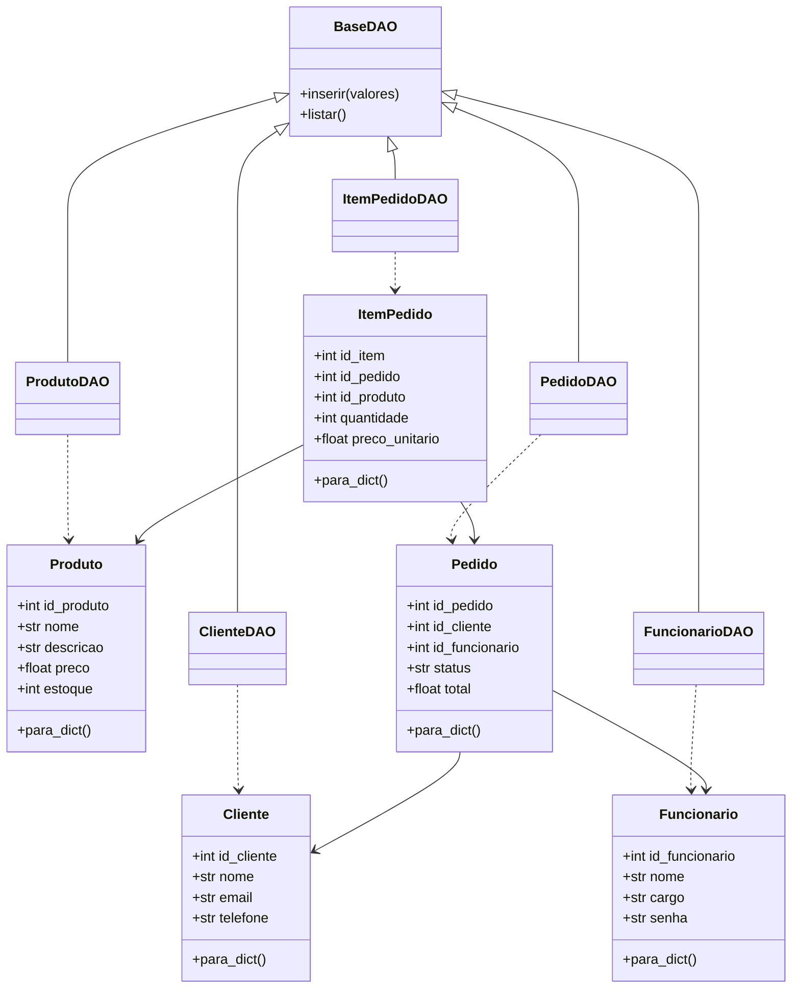

# Diagrama de Programação Orientada a Objetos — RAP 90s STORE

O diagrama abaixo representa as classes utilizadas no back-end. As classes de entidade guardam os dados; as classes DAO fazem a comunicação com o MySQL.

## Conceitos de POO usados

- **Classes e objetos:** cada entidade tem uma classe própria.
- **Encapsulamento:** os dados e os métodos relacionados ficam organizados dentro das classes.
- **Herança:** os DAOs específicos herdam métodos comuns de `BaseDAO`.
- **Abstração:** a classe `BaseDAO` esconde detalhes repetidos de INSERT e SELECT.
- **Associação:** pedidos relacionam clientes e funcionários; itens relacionam pedidos e produtos.
